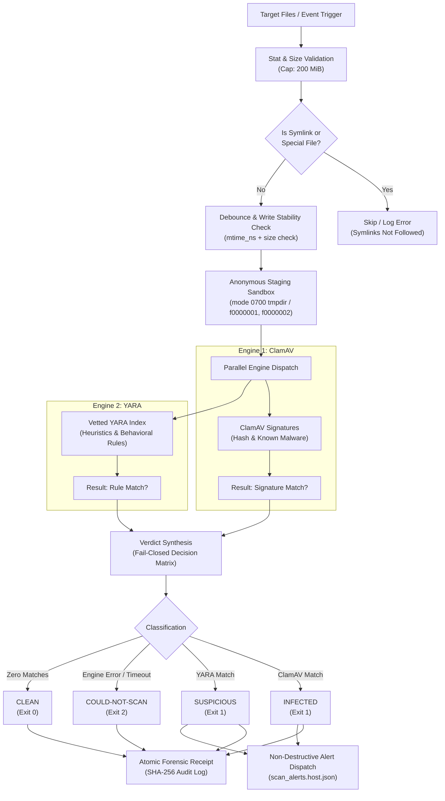
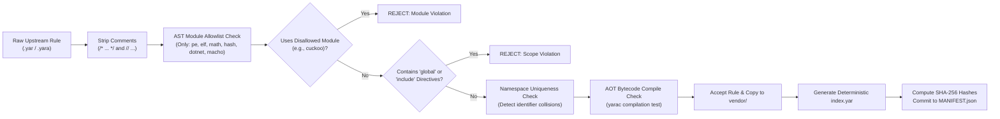

# YARA Threat Defense Engine

[](https://github.com/Ethan-da-Tech-Wizard/yara-threat-defense-engine/actions/workflows/yara-ci.yml)
[](LICENSE)
[](https://www.python.org/)
[](#)
[](#)

A production-grade, offline malware defense and file integrity inspection engine combining **curated compile-time YARA rule vetting** and **ClamAV antivirus integration**. Built entirely with the Python standard library, featuring zero daemon overhead, event-driven filesystem triggers, anonymous symlink staging, and non-destructive forensic quarantine alerting.

---

## Architecture Overview

Traditional antivirus solutions either rely exclusively on static virus databases (failing against novel heuristics and fileless scripts) or run resource-intensive background daemons that exhaust memory, drain batteries, and lock the filesystem.

The **YARA Threat Defense Engine** addresses these challenges using a deterministic, dual-engine scanning pattern:



---

## Threat Classification Hierarchy

The engine enforces a **strict fail-closed evaluation model**: if any engine fails, times out, is uninstalled, encounters permission issues, or receives an oversized file, **the verdict is NEVER reported as CLEAN**.

| Verdict | Exit Code | Priority Rank | Description | Action Required |
|:---|:---:|:---:|:---|:---|
| **`INFECTED`** | `1` | 3 (Highest) | ClamAV signature match. Confirmed virus, trojan, worm, or ransomware hash. | Isolate file immediately. Preserve forensic copy. |
| **`SUSPICIOUS`** | `1` | 2 | YARA rule match. Heuristic anomaly, reverse shell, webshell, or crypto-jacking pattern. | Inspect file context, review matched rules, audit source. |
| **`COULD-NOT-SCAN`** | `2` | 1 | Engine missing, timeout reached, permission denied, or file exceeds size cap. | Check scanner permissions, tool installation, or file limits. |
| **`CLEAN`** | `0` | 0 | Both engines executed successfully with zero signature or rule matches. | Normal operation. *(Note: absence of detection != proof of safety)* |

---

## Core Security & Design Principles

### 1. Dual-Engine Scanning Pattern
- **ClamAV (High-Fidelity Signatures)**: Rapidly matches known, cataloged malware signatures and exact file hashes.
- **YARA (Behavioral & Heuristic Patterns)**: Detects weaponized syntax, piped downloads (`curl | bash`), reverse TCP shells, web shells, and cryptominer connection strings (`stratum+tcp://`).

### 2. Anonymous Symlink Staging Sandbox
To eliminate command injection, path traversal, or shell escaping vulnerabilities in third-party CLI scanners, target files are never passed directly to external binaries by their user-provided names. Instead:
- A private temporary directory is provisioned with POSIX mode `0700` (`rwx------`).
- Target files are mapped to sanitized anonymous symlinks: `f0000000`, `f0000001`, `f0000002`.
- The scanners operate solely on these sanitized references.
- Error logs and findings are mapped back to original file paths via an in-memory dictionary.

### 3. Write Stability & Race Condition Debouncing
Files arriving via network synchronization (Syncthing, rsync) or browser downloads are written in chunks over several seconds. Scanning a file in mid-write generates corrupt hashes and false errors.
- The engine captures a high-resolution stat signature: `(st_size, st_mtime_ns)`.
- It executes a single shared debounce sleep (default: `2.0s`).
- If any file's size or timestamp changed during the wait, the file is skipped and deferred to the next event pass.

### 4. Non-Destructive Quarantine Staging
Automated cleanup scripts that blindly delete or mutate flagged files destroy forensic evidence required for incident triage and root-cause analysis.
- Flagged files remain in-place with unchanged contents.
- Incident alerts with SHA-256 hashes, matched rule names, timestamps, and operator runbook guidance are atomically appended to `data/health/scan_alerts.<host>.json`.

### 5. Memory-Safe AI Model Header Scanning (`gguf_header_scan`)
Machine learning model checkpoints (e.g. GGUF, Safetensors) regularly exceed 10 GB to 70 GB. Attempting to scan entire model weights with pattern matching engines exhausts RAM and triggers kernel Out-Of-Memory (OOM) kills.
- The engine isolates and scans only the first **16 MiB** header window.
- Malicious payloads in models (such as embedded Python pickle bytecodes, executable loaders, or weaponized metadata) reside in the header structure.
- The remaining multi-gigabyte tensor array is bypassed, ensuring a fixed memory ceiling.

### 6. Physical Media (USB) Containment
Removable storage drives are scanned with strict depth bounding (`depth=3`) and file limits (`max_files=5000`) to prevent denial-of-service from directory loops, recursive symlinks, or zip bombs. Windows autorun files (`autorun.inf`) are automatically flagged as security warnings.

---

## Compile-Time YARA Rule Vetting Pipeline

Community YARA feeds often contain unoptimized regular expressions, dangerous external dependencies, or conflicting identifiers. The `twu_yara_vet.py` engine enforces an Ahead-of-Time (AOT) static validation pipeline:



### Static AST Validation Rules:
1. **Module Allowlist**: Only modules that perform deterministic parsing without external network access are allowed: `pe`, `elf`, `math`, `hash`, `dotnet`, `macho`. Modules such as `cuckoo` are rejected.
2. **No Global Rules**: Global rules mutate the evaluation context of all other rules in the compilation unit. They are strictly prohibited.
3. **No Includes**: Rule files must be completely self-contained. Relative `include` directives are rejected.
4. **Namespace Uniqueness**: Duplicate rule names across different vendor feeds are identified and isolated.
5. **AOT Bytecode Compilation**: Every rule is pre-compiled via `yarac` before admission into `index.yar`.
6. **Cryptographic Manifest Tracking**: All accepted files are indexed with SHA-256 hashes in `MANIFEST.json`.

---

## Directory Structure

```text
.
├── .github/
│   └── workflows/
│       └── yara-ci.yml              # CI test matrix across Python 3.10-3.13
├── data/
│   └── yara_rules/
│       ├── EXCLUSIONS.json          # False-positive rules and pinned test fixtures
│       ├── index.yar                # Generated master include file
│       ├── local_selftest.yar       # Local EICAR self-test rule
│       ├── MANIFEST.json            # Cryptographic SHA-256 manifest of all vetted rules
│       ├── README.md                # Vetted rules provenance & refresh instructions
│       ├── security_baseline.yar    # TWU baseline rules (reverse shells, webshells)
│       └── vendor/                  # Curated rules from signature-base & reversinglabs
│           ├── reversinglabs/
│           └── signature-base/
├── scripts/
│   ├── test_twu_scan_event.py       # Unit tests for event-driven scans and USB handling
│   ├── test_twu_scan.py             # Unit tests for dual-engine scanner and receipts
│   ├── test_twu_yara_vet.py         # Unit tests for AST validation and rule vetting
│   ├── twu_scan_event.py            # Event-driven filesystem watcher & alert staging
│   ├── twu_scan.py                  # Core dual-engine scanner CLI and API
│   └── twu_yara_vet.py              # Rule vetting, compilation, and manifest verifier
├── .gitignore
├── LICENSE                          # MIT License
├── pyproject.toml                   # Standard packaging specification
└── README.md                        # Engine architecture & operational runbook
```

---

## CLI Usage Guide

### 1. Dual-Engine File Scanner (`twu_scan.py`)

Scan files or directory trees:
```bash
python3 scripts/twu_scan.py scan /path/to/target /path/to/archive.tar.gz
```

Output as structured JSON:
```bash
python3 scripts/twu_scan.py scan /tmp/downloads --json
```

Check scanner health, engine versions, and signature database freshness:
```bash
python3 scripts/twu_scan.py status
```

Output:
```text
Security scanner status (workstation): ACTIVE
  yara      4.5.8 (/usr/bin/yara)
  clamscan  1.5.4 (/usr/bin/clamscan)
  freshclam 1.5.4 (/usr/bin/freshclam)
  YARA rules: 5375 rules in 1029 files, built 2026-11-08 (0 days old), integrity OK
  ClamAV signatures: 0.1 days old (fresh)
```

Propose or update ClamAV signatures:
```bash
# Check if update is needed (proposal only)
python3 scripts/twu_scan.py update-signatures

# Apply update with explicit approval
python3 scripts/twu_scan.py update-signatures --approve
```

---

### 2. Event-Driven Scanner & Alerts (`twu_scan_event.py`)

Scan newly arrived files (triggered by systemd `.path`, launchd `WatchPaths`, or hook):
```bash
python3 scripts/twu_scan_event.py scan-new /downloads/sample.bin
```

Scan all files modified in the last 24 hours within a monitored directory:
```bash
python3 scripts/twu_scan_event.py scan-new --dir /home/user/Downloads --since-days 1.0
```

Scan attached removable storage (USB volumes):
```bash
python3 scripts/twu_scan_event.py usb
```

---

### 3. Rule Vetting & Integrity Engine (`twu_yara_vet.py`)

Verify cryptographic integrity of all rule files against `MANIFEST.json`:
```bash
python3 scripts/twu_yara_vet.py verify
```

Run false-positive regression testing against a corpus of known-clean system files:
```bash
python3 scripts/twu_yara_vet.py fptest --corpus-file /tmp/clean_files.txt
```

Compile and vet new rules from an upstream checkout:
```bash
python3 scripts/twu_yara_vet.py build \
  --src "signature-base=/tmp/signature-base@de3c725|Detection Rule License 1.1|https://github.com/Neo23x0/signature-base" \
  --only signature-base=yara
```

---

## Local Verification & Testing

The repository includes a comprehensive unit test suite covering dual-engine execution, AST validation, error recovery, file caps, timeout enforcement, and event deduplication.

### Run Rule Integrity Verification
```bash
python3 scripts/twu_yara_vet.py verify
```

### Run All Test Suites
```bash
python3 -m unittest scripts/test_twu_scan.py scripts/test_twu_yara_vet.py scripts/test_twu_scan_event.py
```

Expected output:
```text
..........................................................
----------------------------------------------------------------------
Ran 58 tests in 14.821s

OK
```

---

## License & Authorship

- **Author**: Ethan REDACTED <ethan@REDACTED>
- **Organization**: TWU LLC
- **Copyright**: © 2026 Ethan REDACTED, TWU LLC
- **License**: [MIT License](LICENSE)

Curated third-party YARA rules in `data/yara_rules/vendor/` remain subject to their respective upstream licenses (MIT and Detection Rule License 1.1), as documented in `data/yara_rules/README.md`.
